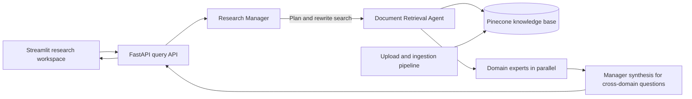

# EV Moto GPT

EV Moto GPT is a document-grounded business research workspace for Hero Motocorp. A manager delegates questions to focused business experts, retrieves evidence from the internal corpus, and synthesizes a cited answer. It also provides a single-pass RAG baseline so the agentic workflow can be compared on the same questions.

The orchestration adapts the manager → retrieval agent → delegated specialist pattern from the [Hugging Face multi-agent RAG cookbook](https://huggingface.co/learn/cookbook/multiagent_rag_system). The cookbook's web and image-generation agents are demo-specific; this project keeps research inside the user's indexed business documents.

## Architecture



The manager can delegate to company and strategy, product and vehicle, sales and performance, pricing and finance, market and competition, or general business research experts. Each expert uses the same retrieved evidence and returns source citations (`[S1]`, `[S2]`). Cross-domain questions can use multiple experts in parallel; the manager combines their findings. The UI exposes the route, evidence, and stage timings.

```text
backend/app/
├── agents/       manager, routing, domain experts, synthesis
├── api/          FastAPI routes and typed request/response schemas
├── core/         environment configuration
├── rag/          document loading, retrieval, pipeline entry point
└── services/     Pinecone, embeddings, and Gemini provider clients
client/           Streamlit research workspace
backend/data/     local document storage (mounted in Docker)
```

Supported inputs are PDF, DOCX, TXT, Markdown, CSV, and Excel. The system does not use external web search, image generation, authentication, or background ingestion jobs.

## Run locally

Use Python 3.11. In PowerShell, from the project root:

```powershell
cd backend
if (Test-Path .venv) { Remove-Item .venv -Recurse -Force }
py -3.11 -m venv .venv
.venv\Scripts\Activate.ps1
python -m pip install -r requirements.txt
if (!(Test-Path .env)) { Copy-Item .env.example .env }
```

Add `GEMINI_API_KEY` and `PINECONE_API_KEY` to `backend/.env`, then start the API:

```powershell
uvicorn app.main:app --reload --port 8001
```

In a second terminal at the project root:

```powershell
pip install streamlit requests
$env:API_URL = "http://127.0.0.1:8001"
streamlit run client/streamlit_app.py
```

The API docs are available at [http://localhost:8001/docs](http://localhost:8001/docs); Streamlit is usually at [http://localhost:8501](http://localhost:8501).

## Configuration

| Variable | Default | Purpose |
|---|---|---|
| `GEMINI_API_KEY` | — | Required for planning and answer generation |
| `PINECONE_API_KEY` | — | Required for document indexing and retrieval |
| `INDEX_NAME` | `ev-gpt-rag` | Pinecone index |
| `PINECONE_NAMESPACE` | empty | Optional corpus namespace |
| `PINECONE_DIMENSION` | `384` | Must match the embedding model output |
| `PINECONE_CLOUD` / `PINECONE_REGION` | `aws` / `us-east-1` | Location when creating an index |
| `EMBEDDING_MODEL` | `sentence-transformers/all-MiniLM-L6-v2` | Local embedding model |
| `GEMINI_MODEL` | `gemini-2.5-flash` | Manager and expert model |
| `CHUNK_SIZE` / `CHUNK_OVERLAP` | `1000` / `150` | Document chunking settings |
| `TOP_K` | `5` | Default evidence passages |
| `DATA_DIRECTORY` | `data` | Document folder relative to `backend` |
| `MAX_UPLOAD_SIZE_BYTES` | `26214400` | Upload limit (25 MiB) |
| `ALLOWED_ORIGINS` | `http://localhost:8501` | Comma-separated browser origins |

An absent Pinecone index is created with the configured dimension. An existing index with a different dimension requires a new index.

## Query modes and evaluation signals

The research workspace offers two modes:

- **Agentic team** — manager planning, query reformulation, evidence retrieval, specialist analysis, and synthesis when multiple experts are selected.
- **Single-pass baseline** — the original style of one retrieval and one general grounded generation call.

Both modes return an `answer`, cited `sources`, the selected `mode`, and stage metrics. Agentic metrics include planning, retrieval, specialist, synthesis, and end-to-end time; baseline uses the same schema, with planning and synthesis at zero. `agent_ms` is wall time for parallel experts (or generation time in baseline mode). Similarity scores are retriever scores, not calibrated confidence. Timings exclude client and network latency.

Example request:

```json
{"query":"Compare sales performance and model pricing by region", "top_k":5, "mode":"agentic"}
```

Use the same questions, documents, `top_k`, model versions, and repeated runs for both modes. The agentic mode also rewrites the retrieval query, so record that as part of the system configuration. Accuracy requires a labeled question, expected answer, and expected evidence set; this repository does not yet include that evaluation dataset.

## API

- `GET /health` — liveness.
- `GET /ready` — checks required provider configuration is present.
- `POST /api/v1/ingest` — index supported files already in `backend/data`.
- `POST /api/v1/documents/upload` — save and index one uploaded file.
- `POST /api/v1/query` — run the agentic workflow or single-pass baseline.

## Docker

Copy `backend/.env.example` to `backend/.env`, add the provider keys, then run from the project root:

```bash
docker compose up --build
```

The API uses port 8001; Streamlit uses port 8501. Uploaded files persist in the mounted `backend/data` directory.
